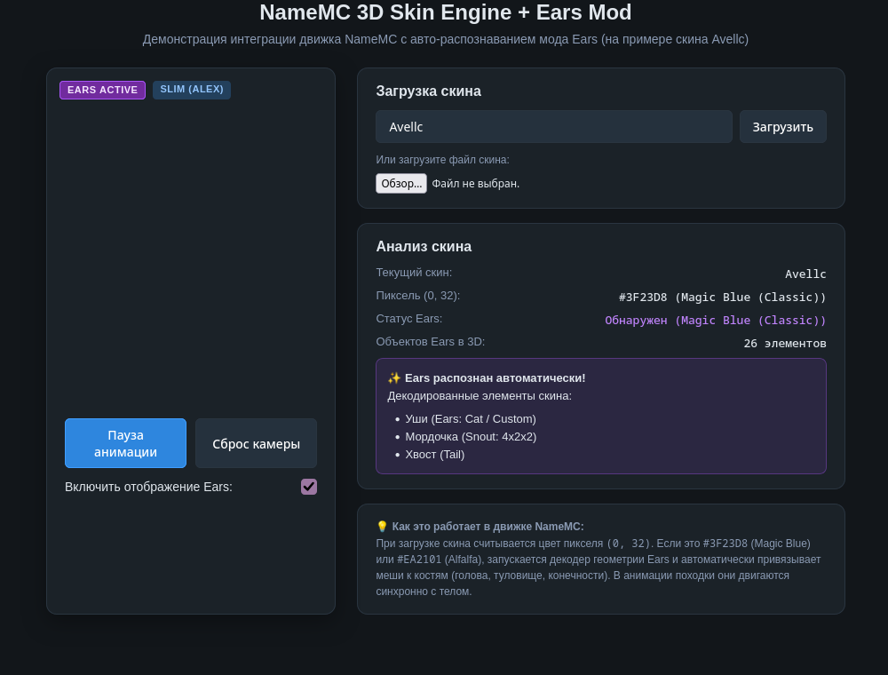
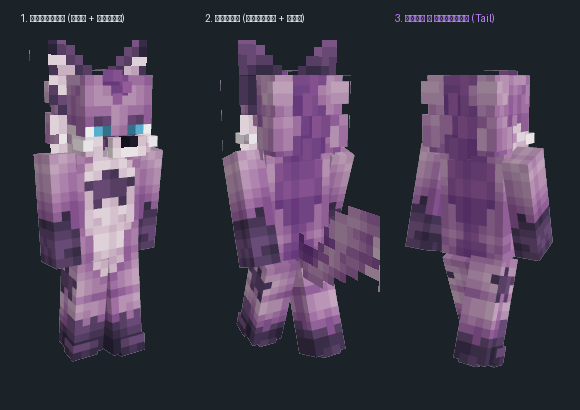

# NameMC 3D Skin Viewer + Ears Mod Integration (POC)

A working proof-of-concept integrating the **NameMC 3D skin rendering engine** with automatic client-side support for the **[Ears mod](https://github.com/unascribed/Ears)** (faithful custom ears, tails, snouts, wings, horns, and claws encoded directly in Minecraft skin pixels).



---

## 🎯 Overview & Motivation

The **Ears mod** (created by Exa Skye / unascribed) is one of the most popular Minecraft cosmetic mods. Unlike *Custom Player Models (CPM)* or *Figura*, Ears requires **no third-party servers or custom APIs**. All configuration data is stored directly in unused pixels of standard Minecraft skin textures (`x: 0..3, y: 32..35`).

Currently on [NameMC](https://namemc.com), skins containing Ears metadata show:
1. "Glitchy" / colored magic pixels in the torso/armpit region.
2. None of the custom 3D geometry (ears, tails, snouts, wings) rendered in the 3D skin viewer.

This repository demonstrates how NameMC can support Ears **natively, client-side, with zero server load and 100% backward compatibility with vanilla skins**.

---

## ✨ Features

- **Automatic Format Detection:**
  - Reads pixel `(0, 32)` on skin load.
  - `#3F23D8` (*Magic Blue*): Ears Classic format.
  - `#EA2101` (*Alfalfa*): Ears v2 compressed binary format (wings, capes, extended features).
  - Any other pixel: Standard vanilla Minecraft skin (Ears pipeline is completely bypassed with 0ms penalty).
- **Non-Invasive Architecture:**
  - Connects to NameMC's Three.js scene hierarchy as an adapter without rewriting the renderer.
  - Attached meshes (`head`, `torso`, `limbs`) move synchronously with NameMC's walk cycle animation and respond to mouse/touch drag rotation.
- **Tested with Real Players:**
  - Includes test skin of player `Avellc` (UUID: `df33e35ab11e481fb9e12eb071375870`, Slim / Alex model), featuring custom cat ears, a 4×2×2 snout, and folded back wings.

---

## 📸 3D Angles Comparison (Avellc Skin)



1. **Front View:** Cat ears extending above vanilla head geometry + 4×2×2 protruding snout.
2. **Back View:** Folded single symmetric wing (20×16 texture extracted dynamically from the skin's Alfalfa data block) + ears from behind.
3. **Tail Demo:** Demonstrates animated tail geometry attached to the torso when `tail-mode` is activated.

---

## 🚀 Live Demo

You can test this live on GitHub Pages:
> **https://avelcfox.github.io/ears_namemc_viewer/**

### Running Locally

Clone this repository and serve with any static web server:

```bash
# Python 3
python3 -m http.server 8080

# Or with Node.js
npx serve .
```

Open `http://localhost:8080` in your browser.

---

## 🛠️ Integration Architecture for NameMC

The integration consists of an adapter hook (`namemc-ears-adapter.js`) that plugs into NameMC's skin loading routine:

```javascript
// Step 1: Detect Magic Pixel at (0, 32)
const ctx = skinCanvas.getContext('2d', { willReadFrequently: true });
const [r, g, b] = ctx.getImageData(0, 32, 1, 1).data;
const rgb = (r << 16) | (g << 8) | b;

if (rgb === 0x3F23D8 || rgb === 0xEA2101) {
  // Step 2: Decode Ears quads (via MIT-licensed ears-common runtime)
  rebuildQuads();

  // Step 3: Attach planar meshes directly to NameMC bone groups
  window.renderObjects.forEach(quad => {
    const mesh = createQuadMesh(quad, textures);
    targetBone.add(mesh); // e.g. head.add(mesh) or torso.add(mesh)
  });
}
```

---

## 📄 License & Credits

- **NameMC 3D Renderer:** Reverse-engineered / extracted for research and interoperability demonstration purposes. All rights to NameMC branding belong to [NameMC](https://namemc.com).
- **Ears Mod Runtime (`ears-common.js`):** Licensed under the **MIT License** © 2021-2026 Exa Skye and contributors.
- **Three.js:** Licensed under the **MIT License** © 2010-2026 Three.js authors.
- **Demo Skin:** Belonging to Minecraft player `Avellc`.
